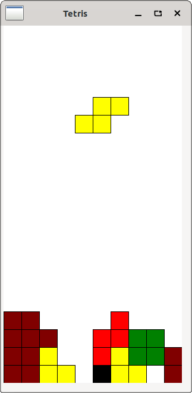
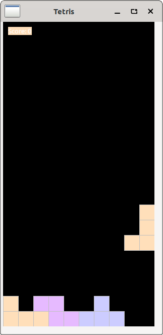
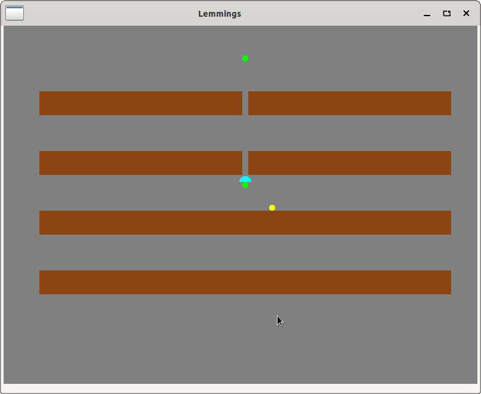
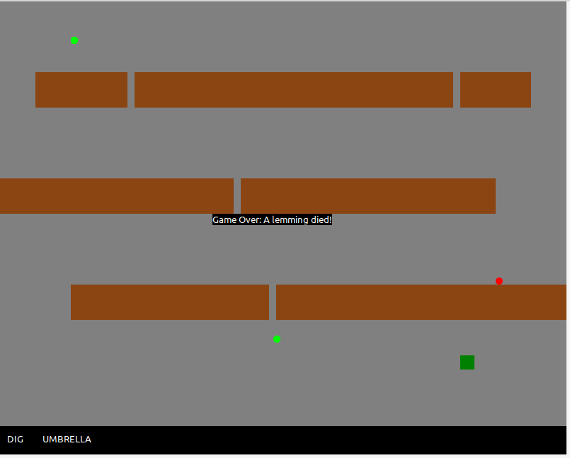
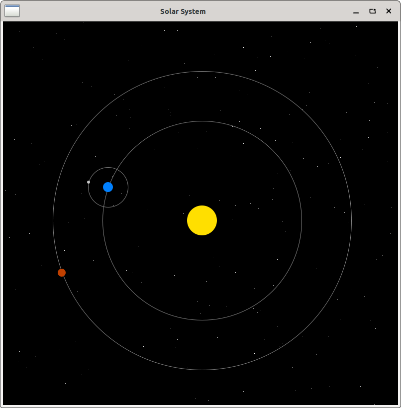
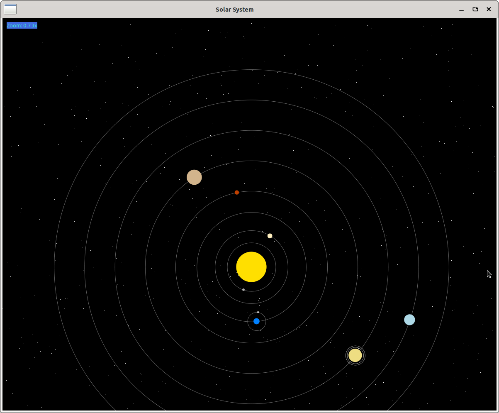
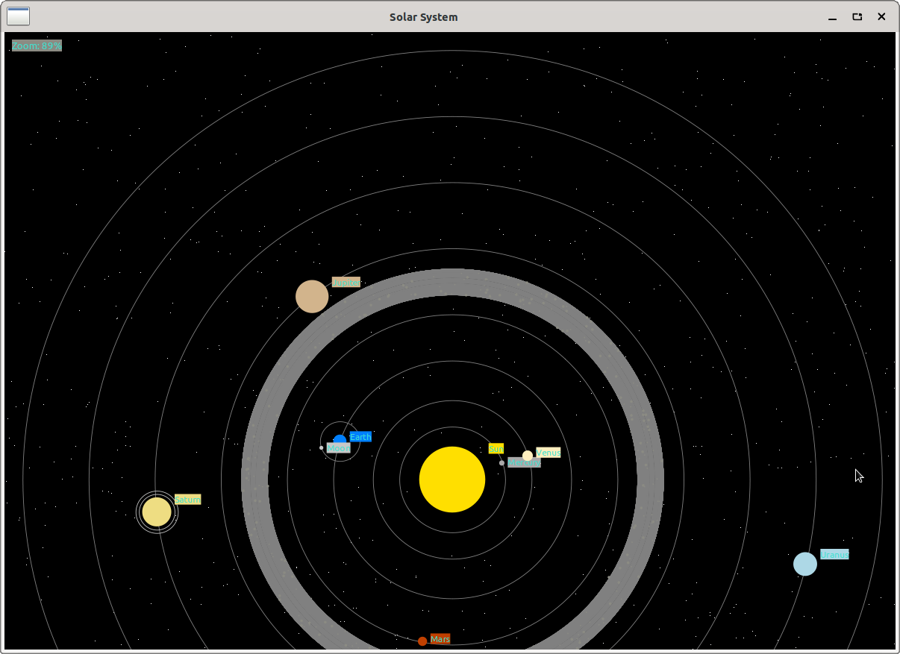

# SWT eclipse
* code using eclipse SWT - Standard Widget Toolkit for GTK on x86_64 

* build and compile using eclipse SWT release zip release
```bash
javac -cp "./swt-4.34-gtk-linux-x86_64/swt.jar" Main.java
java -cp ".:./swt-4.34-gtk-linux-x86_64/swt.jar" Main
``` 

* troubleshooting
```bash
# swt.jar is a signed jar!
java -cp ".:./swt-4.34-gtk-linux-x86_64/swt.jar" Main
#Error: Unable to initialize main class Main
#Caused by: java.lang.SecurityException: Invalid signature file digest for Manifest main attribute
zip -d ./swt-4.34-gtk-linux-x86_64/swt.jar 'META-INF/*.SF' 'META-INF/*.RSA' 'META-INF/*.DSA'
``` 

* build and compile using maven jar 
```bash
javac -cp "org.eclipse.swt.gtk.linux.x86_64-3.128.0.jar" Main.java
java -cp ".:org.eclipse.swt.gtk.linux.x86_64-3.128.0.jar" Main
```

get SWT
* from eclipse rcp page as  `zip`: https://download.eclipse.org/eclipse/downloads/drops4/R-4.34-202411201800/
  * unzip: `unzip swt-4.34-gtk-linux-x86_64.zip -d swt-4.34-gtk-linux-x86_64` 
* or as `jar` from maven repo: https://mvnrepository.com/artifact/org.eclipse.platform/org.eclipse.swt.gtk.linux.x86_64/3.128.0

# Tetris SWT
* code was generated by `gemini-cli` 
```bash
./run.sh Tetris
```

| v1                                       | v2                                                                                              |
|------------------------------------------|-------------------------------------------------------------------------------------------------|
|  | display score<br/>other color palette<br/>particel on row<br/> |

# Lemmings SWT
* code was generated with gemini-cli
```bash
./run.sh Lemmings
```

| v1                                                 | v2                                                                                       |
|----------------------------------------------------|------------------------------------------------------------------------------------------|
|  | game end when lemmings can't alive <br/>menu bar<br/> |

# Solar System SWT
* code was generated with gemini-cli
```bash
./run.sh SolarSystem
```

| v1                                           | v2                                                                                         | v3                                                                                                   |
|----------------------------------------------|--------------------------------------------------------------------------------------------|------------------------------------------------------------------------------------------------------|
|  | <br/>zoom<br/>all planets in solar system<br/> | <br/>display planet names<br/>zoom in %<br/>astroid<br/> |
